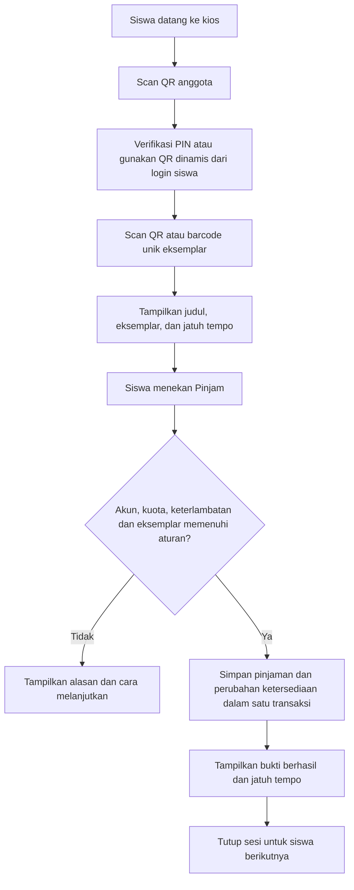

# Analisis dan roadmap perpustakaan self-service

Tanggal tinjauan awal: 27 Oktober 2026. Pembaruan implementasi: 28 Oktober 2026.

> Pembaruan implementasi: database kosong telah di-reset dan tahap inti langsung diterapkan. Proyek sekarang memakai Laravel 12.70.1, kartu anggota QR permanen + PIN, QR/kode inventaris otomatis, pemetaan barcode eksemplar, checkout kiosk tanpa approval admin, UI inventaris/cetak QR production, penerbitan ulang kartu, dan decoder scanner lokal. Detail awal di bawah dipertahankan sebagai rekaman kondisi sebelum upgrade.

**Posisi saat ini: MVP perangkat lunak peminjaman mandiri satu buku sudah tersedia.** Siswa memakai kartu QR + PIN, memindai QR/barcode unik buku, lalu mengonfirmasi transaksi tanpa persetujuan petugas. Tahap berikutnya adalah validasi MySQL bersamaan, uji scanner/kamera dan browser kios fisik, rekonsiliasi koleksi, serta uji operasional sekolah.

## Status implementasi 28 Oktober 2026

| Tahap roadmap | Status | Bukti utama |
|---|---|---|
| 0. Baseline | Selesai untuk source/test | Suite 21 tes/85 assertion lulus; audit Composer dan npm bersih |
| 1. Platform/aset | Selesai untuk aplikasi | Laravel 12.70.1, Vite 8.3.5, decoder kamera lokal |
| 2. Identitas anggota | Selesai | Provisioning otomatis, QR permanen, PIN hash, cetak dan terbit ulang |
| 3. Eksemplar/barcode | Selesai untuk database kosong | QR/kode otomatis, barcode unik, UI status dan cetak batch |
| 4. Checkout siswa | Selesai untuk MVP satu buku | Device credential, sesi anggota, aturan pinjam, transaksi idempoten tanpa approval admin |
| 5. Pengembalian | Sebagian | Jalur petugas/pilot tersedia; konsolidasi UI dan kebijakan kondisi fisik masih perlu |
| 6. Uji sekolah | Belum | Scanner, kamera, HTTPS kiosk, concurrency MySQL, backup/restore dan beban belum dibuktikan di lokasi |

MySQL lokal yang sebelumnya dipakai berhasil dimigrasikan dan di-seed pada 27 Oktober. Saat verifikasi lanjutan 28 Oktober, service MySQL menolak koneksi pada `127.0.0.1:3306`; karena itu perubahan terbaru diverifikasi melalui SQLite test suite, lint PHP, cache Blade/route, build production, dan audit dependensi. Jalankan kembali migrasi/status serta uji concurrency setelah MySQL aktif.

Dokumen ini berdasarkan pembacaan source yang ada di workspace, termasuk perubahan lokal yang belum di-commit, pengujian PHPUnit, serta pemeriksaan konfigurasi dan skema secara read-only. Pengujian browser, scanner fisik, ESP32, concurrency MySQL, dan restore backup belum dilakukan dalam tinjauan ini. Tidak ada perubahan kode aplikasi atau konfigurasi dalam pekerjaan analisis ini.

## 1. Posisi proyek berdasarkan bukti

| Area | Yang sudah tersedia | Jarak menuju tujuan |
|---|---|---|
| Administrasi | Login, role admin/siswa, status akun, katalog, anggota, pengajuan, persetujuan, pengembalian, denda, laporan | Aturan sirkulasi perlu konsisten di semua jalur |
| QR anggota | `LIBMEM1`, token acak, berlaku 90 detik, sekali pakai, dibuat saat siswa membuka `/user/kiosk/pass` | Belum otomatis membuat identitas/kartu QR permanen ketika mendaftar atau ditambah admin |
| QR buku | `LIBBOOK1`, mengarah ke satu eksemplar dalam `library_kiosk_book_copies` | Dibuat manual lewat modul LAB; belum terintegrasi dengan tambah buku/penambahan eksemplar |
| Barcode lama/ISBN | Input scanner USB tersedia | Resolver hanya menerima format QR khusus; belum ada pemetaan barcode lama/ISBN ke katalog atau eksemplar |
| Kios siswa | Enrollment perangkat, credential terpisah dari login admin, scan anggota dan buku, timeout | Berhenti pada status `validated`; belum ada konfirmasi peminjaman oleh siswa |
| Transaksi kios | Pilot dengan transaksi database, pemeriksaan stok dan audit | Approval admin masih diperlukan di kios publik; pilot diblokir pada environment production |
| Multi-buku | Sesi menyimpan satu `copy_id` | Keranjang beberapa buku belum ada; bukan syarat MVP satu buku |
| Pengembalian kios | Pilot penerimaan fisik oleh petugas | Belum menerima pengembalian fisik otomatis |
| RFID | Registrasi kartu anggota, reader bertanda tangan HMAC, nonce, heartbeat/diagnostik | Tidak menjadi prasyarat untuk menyelesaikan MVP QR/barcode |
| Operasional | Toolkit Windows, TLS, starter Debian, pemeriksa kesiapan | Perlu upgrade platform, aset lokal, pengujian perangkat dan bukti operasional |

Urutan perkembangan yang terlihat dari source/dokumentasi: baseline administrasi dan keamanan → RFID → QR multikanal/LAB → kios dengan credential perangkat → checkout pilot 009 → return pilot 010 → toolkit hostname/TLS dan Debian 011. Nomor patch terakhir menunjukkan urutan pekerjaan, bukan persentase kesiapan self-service.

Bukti utama:

- [Registrasi siswa](../app/Http/Controllers/AuthController.php), [tambah anggota oleh admin](../app/Http/Controllers/AnggotaController.php): membuat akun tanpa provisioning kartu QR; registrasi mandiri langsung berstatus `aktif`.
- [KioskOmnichannelController](../app/Http/Controllers/KioskOmnichannelController.php): `memberPass()` membuat QR 90 detik; `createCopy()` membuat QR eksemplar dan masih memanggil `onlyLab()`.
- [KioskQrResolver](../app/Services/KioskQrResolver.php): menerima `LIBMEM1` dan `LIBBOOK1`; membedakan bukti pinjaman `LIBQR1`; kode lain ditolak.
- [KioskStationService](../app/Services/KioskStationService.php): scan kios publik tidak membuat pinjaman.
- [KioskCheckoutPilot](../app/Services/KioskCheckoutPilot.php) dan [routes](../routes/web.php): checkout kios publik disetujui melalui endpoint admin.
- [KioskCirculation](../app/Services/KioskCirculation.php): jalur sirkulasi LAB dapat membuat pinjaman saat flag pilot aktif, tetapi jalurnya memakai autentikasi admin; ini belum alur mandiri siswa.
- [LoanWorkflow](../app/Services/LoanWorkflow.php): sudah memusatkan perubahan status dan stok dalam transaksi dengan penguncian baris.

## 2. Hasil pemeriksaan lokal

| Pemeriksaan | Hasil | Makna |
|---|---|---|
| Runtime CLI | PHP 8.2.34; Laravel 10.50.2 | Platform masih perlu diperbarui |
| PHPUnit dengan SQLite `:memory:` | 17 tes, 53 assertion, 16 lulus, 1 gagal | Bukan bukti seluruh kios sudah lolos; suite berfokus pada role, transaksi dasar dan RFID |
| Tes gagal | `Tests\Feature\ExampleTest`: GET `/` menghasilkan 500; log menunjukkan `no such table: buku` | Tes ini tidak menyiapkan skema database; `RefreshDatabase` masih dikomentari. Jangan disimpulkan bahwa database operasional kehilangan tabel |
| `php artisan migrate:status` | Semua migrasi yang ditampilkan berstatus Ran, termasuk checkout dan return pilot | Skema lokal sudah mencapai patch return pilot |
| `php artisan perpus:production-check` | 12 PASS, 3 BLOCK, 4 MANUAL | Checker mengidentifikasi framework, versi PHP menurut ambang internal, dan environment non-production sebagai BLOCK |
| Konfigurasi melalui checker | MySQL tersambung, debug mati, URL HTTPS, secure cookie aktif, pilot checkout nonaktif | Ini pemeriksaan konfigurasi CLI; kepercayaan sertifikat dan perilaku browser masih harus diuji |
| Decoder lokal | `public/vendor/html5-qrcode.min.js` tidak ditemukan | Kode fallback mengandalkan CDN bila decoder browser tidak tersedia |

Catatan: checker memiliki ambang versi PHP yang ditulis tetap di source dan selalu mengembalikan `production_ready=false`. Hasilnya adalah daftar pemeriksaan, bukan sertifikat keamanan. Ambang versi harus diselaraskan dengan rilis resmi saat upgrade; environment non-production sesuai untuk tahap pengembangan sekarang.

Laravel 10 berakhir dukungan keamanan pada 4 Februari 2025. Per tanggal tinjauan, Laravel 13 mendukung PHP 8.3–8.5 dan mendapat dukungan keamanan sampai 17 Maret 2028. Target yang disarankan adalah Laravel 13 setelah kompatibilitas paket QR, Excel dan autentikasi diverifikasi; jalankan upgrade bertahap dan regression test. [Sumber resmi Laravel](https://laravel.com/framework/docs/13.x/releases#support-policy).

## 3. Target identitas anggota

Pisahkan **identitas anggota yang tetap** dari **bukti autentikasi untuk meminjam**.

- Saat siswa mendaftar, ditambah admin, atau diimpor, buat `member_code` unik serta token kartu acak. QR tidak perlu memuat nama, email atau NIS mentah.
- Akun lama mendapatkan identitas melalui proses pengisian data bertahap yang dapat diulang tanpa membuat identitas ganda.
- Kartu QR tersedia di profil, bisa diunduh/dicetak, dan bisa dicabut atau diganti jika hilang.
- Status boleh meminjam ditentukan server. QR boleh sudah dibuat untuk akun yang belum diverifikasi, tetapi akun tersebut belum boleh melakukan transaksi.
- Sesuaikan istilah NIM/prodi menjadi NIS/kelas bila memang digunakan di sekolah; perubahan label dapat dilakukan lebih awal, migrasi struktur dilakukan setelah kebutuhan disepakati.

Asumsi rancangan: siswa tidak semuanya membawa HP. Jalur utama adalah **kartu QR + PIN pribadi pada kios**; PIN disimpan sebagai hash, percobaan dibatasi, dan pemulihan melalui petugas. QR statis sendiri mudah difoto, sehingga tidak cukup sebagai satu-satunya bukti pemilik akun.

QR dinamis 90 detik yang sudah ada tetap dapat menjadi alternatif bagi siswa yang login di HP. Identitas permanen dibuat sekali, sementara token dinamis diterbitkan saat dibutuhkan; token 90 detik tidak cocok dicetak sebagai kartu anggota permanen.

Untuk pendaftaran, cocokkan NIS dengan daftar siswa sekolah atau gunakan aktivasi awal oleh petugas. Verifikasi keanggotaan sekali ini berbeda dari approval setiap transaksi: setelah aktif, siswa meminjam sendiri.

## 4. Dua opsi identifikasi buku

Permintaan “scan barcode, daftarkan, lalu scan lagi otomatis dikenali” bisa diwujudkan melalui **pemetaan kode ke ID internal**. Isi barcode lama tidak perlu diubah.

| Jenis kode yang dipindai | Dipetakan ke | Perilaku |
|---|---|---|
| QR buatan aplikasi | Satu eksemplar | Langsung tampilkan buku fisik yang sesuai |
| Barcode inventaris lama yang unik per buku fisik | Satu eksemplar | Setelah didaftarkan sebagai alias, scan berikutnya langsung mengenali eksemplar yang sama |
| ISBN/barcode penerbit | Judul/edisi/format | Cari katalog; saat meminjam tetap minta kode eksemplar yang unik |

ISBN mengenali judul, edisi dan format; beberapa buku fisik dari edisi yang sama dapat memiliki ISBN sama. Karena itu, ISBN tidak dapat menentukan salinan mana yang dibawa siswa. [Sumber International ISBN Agency](https://www.isbn-international.org/content/what-isbn/10).

Contoh: katalog “Matematika Kelas X” mempunyai tiga eksemplar `EKS-001`, `EKS-002`, `EKS-003`. Ketiganya dapat memiliki ISBN sama. Masing-masing harus memiliki kode inventaris unik atau stiker QR aplikasi. Jangan otomatis memilih eksemplar pertama yang tersedia ketika yang dipindai hanya ISBN.

Alur pendaftaran oleh admin:

1. Scan barcode lama atau pilih input manual.
2. Tentukan jenis kode: ISBN katalog atau kode inventaris eksemplar.
3. Jika kode dikenal, tampilkan data yang sudah ada; hindari membuat duplikat.
4. Jika belum dikenal, kaitkan dengan katalog/eksemplar yang tepat, lalu simpan.
5. Buat QR eksemplar otomatis bila diperlukan dan sediakan cetak label satuan maupun batch.
6. Pada scan berikutnya, pencarian berjalan di database lokal tanpa perlu internet.

Barcode tidak otomatis berisi judul dan penulis. Pengisian metadata dari layanan luar adalah fitur tambahan, membutuhkan sumber data dan konfirmasi admin, serta harus tetap mempunyai input manual.

Resolver perlu mendukung QR dan barcode inventaris, serta respons khusus untuk ISBN yang belum menunjuk eksemplar. Simpan kode sebagai string agar nol di depan tidak hilang. Terapkan keunikan alias secara database, aturan normalisasi sesuai tipe kode, dan cegah kode baru menimbulkan hasil ambigu. Mode kamera native saat ini hanya mengaktifkan `qr_code`; dukungan format barcode harus diuji juga pada kamera dan scanner USB yang dipakai.

## 5. Alur peminjaman akhir

Konfirmasi dilakukan siswa; admin tidak menyetujui setiap pinjaman. Scan saja belum berarti transaksi berhasil. Status sukses hanya muncul sesudah server memastikan transaksi tersimpan.

MVP cukup satu buku per transaksi. Keranjang beberapa buku ditambahkan setelah alur tersebut stabil. Untuk keranjang, tetapkan apakah semua buku harus berhasil bersama atau siswa perlu menghapus item bermasalah sebelum konfirmasi; rekomendasi awal adalah satu transaksi atomik untuk seluruh keranjang.

Jika koneksi putus setelah siswa menekan Pinjam, kios harus bisa mencari hasil transaksi dengan kunci permintaan yang sama. Mengirim ulang tidak boleh menghasilkan pinjaman kedua. Ketika offline, jangan menyatakan pinjaman berhasil atau mengubah stok hanya di browser.

## 6. Kekurangan yang harus diprioritaskan

| Prioritas | Temuan | Tindakan |
|---|---|---|
| P0 | Kios publik belum punya checkout siswa | Tambahkan endpoint terotorisasi untuk perangkat dan sesi anggota; gunakan layanan transaksi bersama; jangan hanya memindahkan endpoint approval admin menjadi publik |
| P0 | Katalog memiliki `stock`, eksemplar hanya memiliki `active`, keterpinjaman eksemplar ditelusuri melalui audit kios | Jadikan status eksemplar dan hubungan pinjaman-eksemplar sebagai data bisnis utama untuk semua jalur |
| P0 | Batas pinjaman dan keterlambatan diperiksa di layanan kios, tetapi tidak dipusatkan dalam `LoanWorkflow::request()` | Satukan kebijakan agar jalur katalog/admin/kios mengikuti aturan yang sama; pengecualian petugas harus eksplisit dan diaudit |
| P0 | Checkout mengunci judul, tetapi pemeriksaan kuota belum mengunci siswa | Risiko dua kios meminjamkan judul berbeda untuk siswa sama hingga melewati kuota. Perbaiki penguncian lintas jalur dan buktikan dengan uji MySQL bersamaan; risiko ini belum direproduksi dalam audit |
| P0 | QR statis dan barcode buku bisa disalin | Autentikasi anggota terpisah, hanya perangkat terdaftar boleh checkout, ada bukti transaksi dan audit; label bukan bukti penerimaan fisik |
| P1 | Pembuatan QR anggota/buku terpisah dari CRUD utama; QR buku berada di LAB | Buat provisioning otomatis, pengisian data lama, cetak ulang, pencabutan, dan UI operasional di luar LAB |
| P1 | Belum ada lookup barcode | Tambahkan skema alias, validasi konflik, resolver dan dukungan format scanner |
| P1 | Lama pinjam konfigurabel di kios, tetapi denda memakai 7 hari dan Rp2.000/hari tetap dalam workflow | Simpan jatuh tempo dan kebijakan relevan pada transaksi; satukan perhitungan agar perubahan aturan tidak mengubah pinjaman lama secara tidak sengaja |
| P1 | Belum ada tes otomatis khusus keseluruhan kios dan barcode di suite yang ditemukan | Uji sesi, replay, perangkat dicabut, checkout ulang, kuota, pengembalian dan gangguan koneksi |
| P1 | Laravel lama; decoder lokal tidak tersedia; sejumlah tampilan memakai CDN | Upgrade platform dan paket, sediakan aset lokal, uji tanpa akses internet selama LAN/server masih aktif |
| P2 | Tampilan kios masih memuat istilah LAB/pilot serta upload foto QR | Buat tampilan siswa dengan langkah singkat; pisahkan fasilitas diagnostik dari kios operasional |
| P2 | Potensi beda perilaku Windows/Linux: `view('home')` tetapi file `Home.blade.php` | Selaraskan casing dan uji pada Linux sebelum menggunakan toolkit Debian |
| P2 | Registrasi menggunakan NIM/prodi dan langsung mengaktifkan akun | Sesuaikan data sekolah dan proses validasi keanggotaan |

Kehadiran `lockForUpdate`, hash token, CSRF, pembatasan role dan idempotensi pilot adalah fondasi yang baik. Perluasan self-service harus mempertahankannya dan memperluas jaminannya ke semua jalur transaksi.

## 7. Perubahan data yang disarankan

Ini rancangan, belum migrasi yang dijalankan:

| Data | Perubahan |
|---|---|
| `users` / identitas anggota | Kode anggota unik, credential kartu yang dapat dicabut, hash PIN, status verifikasi; pertahankan QR dinamis terpisah |
| `buku` | Tetap menjadi katalog judul/edisi; tambahkan ISBN bila diperlukan |
| `library_kiosk_book_copies` | Kembangkan tabel yang ada menjadi eksemplar operasional: kode inventaris unik, status tersedia/dipinjam/rusak/hilang/nonaktif, lokasi dan kondisi |
| Identitas pemindaian | Pemetaan unik barcode inventaris ke eksemplar; pisahkan ISBN katalog agar tidak dianggap unik per salinan |
| `peminjaman` | Hubungan ke eksemplar, jatuh tempo eksplisit, asal transaksi, perangkat dan sesi; data lama boleh belum memiliki eksemplar selama rekonsiliasi |
| Sesi checkout | Anggota terautentikasi, masa berlaku, status, kunci idempotensi; untuk tahap keranjang tambahkan daftar item |
| Audit | Catat pelaku siswa, perangkat, aksi, hasil dan koreksi; jangan memalsukan `approved_by` admin untuk transaksi otomatis |

Migrasi data lama tidak boleh sekadar membuat jumlah eksemplar sebanyak `stock`. Pada workflow sekarang, `stock` berkurang ketika dipinjam, sehingga merupakan ketersediaan, bukan jumlah fisik keseluruhan. Rekonsiliasi stok tersedia, pinjaman aktif, kerusakan/kehilangan, dan buku fisik; data pinjaman lama mungkin belum cukup untuk menentukan eksemplar tanpa pemeriksaan.

Selama transisi, pembaruan status eksemplar dan stok agregat harus berada dalam transaksi yang sama. Setelah rekonsiliasi, stok tersedia dapat dihitung dari eksemplar atau disimpan sebagai agregat yang diperiksa konsistensinya. Hindari edit angka stok bebas yang melewati perubahan inventaris.

## 8. Roadmap pengerjaan

Estimasi awal untuk satu pengembang yang sudah memahami Laravel dan bisa mengakses perangkat sekolah. Durasi bukan janji; volume pelabelan, kualitas data dan kompatibilitas paket dapat menambah waktu. Urutan dependensi lebih penting daripada nomor minggu.

| Tahap | Fokus dan hasil kerja | Syarat selesai | Estimasi |
|---|---|---|---|
| 0 | Tetapkan baseline, dokumentasikan perubahan lokal, siapkan staging dan backup, benahi fixture tes, sepakati aturan siswa | Suite baseline hijau, restore berhasil pada database terpisah, aturan kuota/durasi/denda/identitas tertulis | 2–3 hari |
| 1 | Upgrade Laravel/PHP dan dependensi, rapikan casing Linux, sediakan aset lokal | Login, CRUD, QR, laporan dan transaksi lama tetap lolos; aplikasi bisa diuji tanpa CDN | 4–7 hari |
| 2 | Identitas anggota otomatis, kartu cetak, PIN dan alternatif QR dinamis, isi identitas akun lama | Daftar lewat siswa/admin menghasilkan identitas tepat sekali; kartu dicabut dan akun nonaktif ditolak | 3–5 hari |
| 3 | Eksemplar sebagai inventaris utama, barcode alias, QR otomatis dan cetak batch, rekonsiliasi awal | Dua salinan satu judul bisa dibedakan; barcode yang sama selalu mengenali objek yang sama; ISBN ambigu tidak dipakai checkout | 5–8 hari |
| 4 | Satu layanan kebijakan sirkulasi dan checkout siswa satu buku, idempotensi, bukti transaksi, reset sesi | Siswa meminjam tanpa approval admin; scan/klik ulang tidak menggandakan transaksi; uji dua kios lulus | 5–8 hari |
| 5 | Pengembalian konsisten per eksemplar, keterlambatan/denda, laporan pengecualian dan rekonsiliasi | Stok/status pulih tepat sekali; tidak ada klaim pengembalian selesai hanya dari scan QR | 3–5 hari |
| 6 | Uji pemakaian dengan siswa dan petugas, scanner sebenarnya, gangguan Wi-Fi, restart server dan pemantauan | Setiap transaksi cocok dengan buku fisik; hasil uji dan masalah dicatat; tidak ada masalah kritis terbuka | 5 hari operasional |
| 7 | Peningkatan setelah MVP: keranjang multi-buku, pengingat jatuh tempo, impor massal lanjutan, integrasi RFID, opsi drop-box | Tiap fitur lulus kriteria tersendiri tanpa merusak alur satu buku | Estimasi terpisah |

Tahap 0–6 sekitar 27–41 hari kerja, atau kurang lebih 6–9 minggu termasuk uji sekolah, di luar pelabelan koleksi besar dan pengadaan. Tahap 4 adalah capaian fungsional inti; tahap 5–6 diperlukan agar pemakaiannya dapat dipertanggungjawabkan secara operasional.

Pekerjaan awal yang paling konkret: stabilkan baseline, lalu tetapkan identitas anggota dan eksemplar. Setelah keduanya jelas, barcode dan checkout otomatis memiliki objek yang pasti untuk diproses.

## 9. Pengembalian dan batas ruang lingkup

Tujuan utama pengguna adalah peminjaman mandiri. Untuk rilis pertama, peminjaman bisa sepenuhnya mandiri sementara penerimaan pengembalian tetap diverifikasi petugas.

Jika kelak pengembalian juga harus tanpa petugas: siswa scan buku dan menyerahkan ke drop-box, sistem mencatat `menunggu_pemeriksaan`, lalu buku menjadi tersedia setelah penerimaan/kondisi terverifikasi. Pengembalian yang langsung selesai otomatis memerlukan rancangan penerimaan fisik dan pengujian perangkat tambahan. Scan label atau foto QR saja tidak membuktikan buku sudah diserahkan.

## 10. Kriteria akhir MVP

- [x] Siswa baru dan anggota lama memiliki identitas QR unik; pembuatan ulang proses tidak menduplikasi anggota.
- [x] Siswa dapat memakai kartu + PIN tanpa HP, atau QR dinamis dari akun yang sudah login.
- [x] QR eksemplar dibuat otomatis saat inventaris ditambahkan dan dapat dicetak ulang.
- [x] Barcode inventaris lama yang sudah dipetakan dan QR aplikasi mengenali eksemplar yang sama.
- [x] Dua buku fisik dengan ISBN sama tetap memiliki identitas berbeda; ISBN tidak memilih salinan secara sembarang.
- [x] Siswa melakukan satu transaksi dari awal sampai bukti berhasil tanpa login atau approval admin.
- [x] Akun nonaktif, kuota penuh, buku dipinjam, dan keterlambatan ditangani oleh layanan kebijakan bersama.
- [ ] Dua kios berebut eksemplar terakhir menghasilkan tepat satu pinjaman; dua kios untuk siswa sama tidak melewati kuota.
- [x] Klik ulang dengan kunci permintaan yang sama tidak membuat pinjaman atau perubahan stok ganda.
- [x] Pembatalan/timeout membersihkan identitas siswa; siswa berikutnya tidak mewarisi sesi.
- [ ] Pengembalian membuat status dan stok benar tepat sekali, dengan penerimaan fisik yang dapat dipertanggungjawabkan.
- [ ] Browser kios, HTTPS, scanner USB/kamera dan server sekolah telah diuji langsung.
- [ ] Backup dapat dipulihkan dan laporan transaksi cocok dengan inventaris fisik.

Uji otomatis berikutnya harus menutup skenario di atas. Tes SQLite yang lulus belum membuktikan penguncian transaksi di MySQL; pengujian permintaan bersamaan perlu database MySQL staging terpisah.
